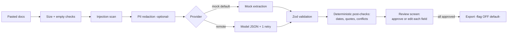

# Partner & Proposal Intelligence Assistant (demo)

A small, honest AI workflow demo: paste a **funding call** and a **partner profile**,
get a structured, source-quoted summary that a **person reviews and approves**
before anything is exported.

Live page: `/ai-solutions` (mock mode — no key, no cost).

## Run locally (mock mode)

```bash
pnpm install
pnpm dev
# open http://localhost:3000/ai-solutions → "Load sample" → "Analyze"
```

No API key needed. Tokens and costs shown are estimates (`chars / 4`).

## Run with a real model key

The demo is provider-agnostic (OpenAI-compatible endpoint, e.g. OpenRouter).

1. Set public vars (endpoint + model only — never secrets):
   `VITE_AI_DEMO_MODE=remote`, `VITE_AI_DEMO_BASE_URL`, `VITE_AI_DEMO_MODEL`.
2. Open `/ai-solutions`, paste documents, paste your key into the UI field
   (memory only — never logged, stored, or committed).
3. Analyze. On schema failure the app retries **once** with the validation
   error, then fails safely with a plain message.

See `.env.example` (root) for the variable list.

## Architecture



## Design decisions (short)

- **Plain code** for dates, arithmetic, currency, validation, redaction,
  injection patterns, quote checks. **Model only** for reading messy wording.
- Every field carries a **source quote** or is `"not found"` — never guessed.
- Pasted docs are **data, not instructions**; injection attempts are flagged
  and capped at a weak fit; model output never triggers actions directly.
- **Human approval gates export.** Nothing is sent automatically.
- **Cost is visible**: tokens + $/doc + $/1,000 on every run.
- **Storage**: nothing by default. No raw text in logs (lengths/flags only).

## Limits and known risks

- Mock mode is rule-based: good for structure, weak on paraphrase.
- `.txt`/`.md` upload only; PDF/DOCX parsing is a next step.
- Remote mode sends redacted text to a third party — needs a DPA for real data.
- Eval set is 10 cases; grow it before trusting new models/prompts.
- [ADD REAL FACT: chosen production model id and price]
